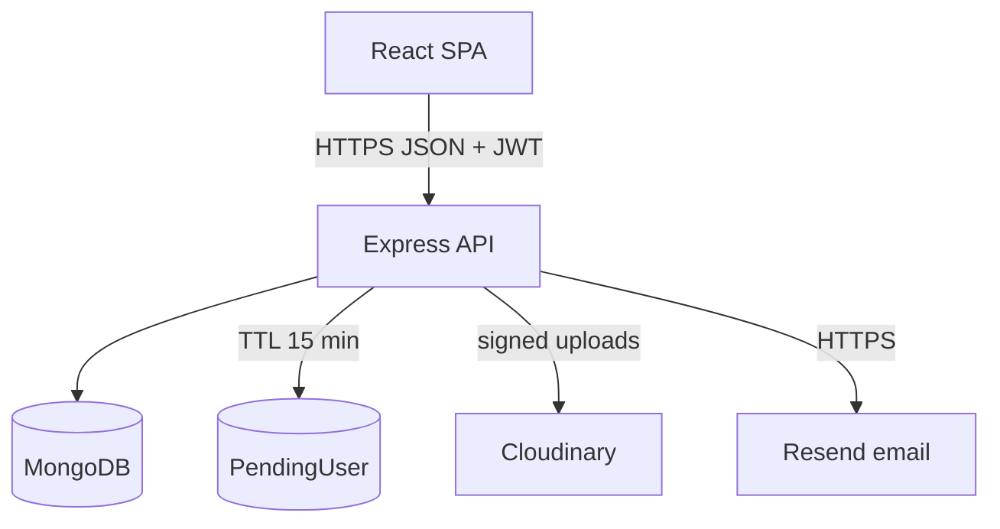
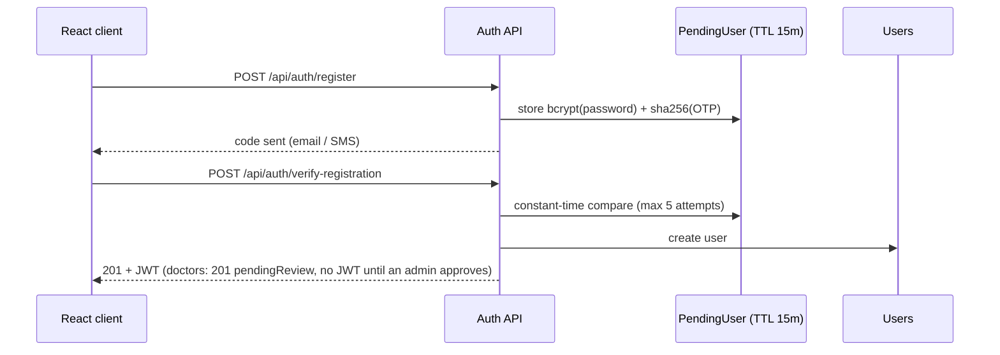

# MedEasy — Full-Stack Digital Healthcare Portal

[](https://nodejs.org/)
[](https://react.dev/)
[](https://vitejs.dev/)
[](https://expressjs.com/)
[](https://www.mongodb.com/)

**MedEasy** ([medeasy.systems](https://medeasy.systems)) is a responsive full-stack healthcare platform for Pakistan:
patients order medicines, upload prescriptions and book doctors; pharmacies manage inventory, orders and
prescription verification; doctors manage appointments; administrators audit professionals and the platform.

---

## Contents

1. [Tech stack & architecture](#tech-stack--architecture)
2. [Quick start](#quick-start)
3. [Environment variables](#environment-variables)
4. [Scripts](#scripts)
5. [Project structure](#project-structure)
6. [Design system](#design-system)
7. [API conventions](#api-conventions)
8. [Security](#security)
9. [Testing & quality](#testing--quality)
10. [Seed accounts](#seed-accounts)
11. [Key features](#key-features)
12. [Deployment](#deployment)

---

## Tech stack & architecture

| Layer | Technology |
| --- | --- |
| Frontend | React 19, Vite 8, React Router 7, React-Bootstrap 2 (themed via design tokens), react-icons, Chart.js |
| Backend | Node.js 20+, Express 5, Mongoose 9, Zod validation, helmet, express-rate-limit |
| Data | MongoDB (Atlas in production, in-memory for tests / `dev:memory`) |
| Media | Cloudinary (uploads), Render static fallback for seed images |
| Email | Resend HTTP API (OTP, password reset, contact form) |



---

## Quick start

**Prerequisites:** Node.js 20+ and npm. MongoDB is optional for local development (see `dev:memory`).

```bash
# 1. Install everything (root, frontend, backend)
npm install
npm run install-all

# 2. Configure env files
cp backend/.env.example backend/.env       # then fill in values
cp frontend/.env.example frontend/.env

# 3a. Zero-setup: API on a seeded in-memory MongoDB + frontend
npm run dev:memory

# 3b. …or with your own MongoDB (set MONGO_URI in backend/.env)
npm run seed --prefix backend   # optional demo data
npm start                       # backend :5000 + frontend :5173
```

Open <http://localhost:5173>. API health check: <http://localhost:5000/api/health>.

---

## Environment variables

Backend variables are validated at startup by [backend/config/env.js](backend/config/env.js); the server
refuses to start with a clear message if something required is missing.

### Backend (`backend/.env`)

| Variable | Required | Default | Description |
| --- | --- | --- | --- |
| `NODE_ENV` | – | `development` | Set **`production`** on your host (hides internal errors, strict CORS). |
| `PORT` | – | `5000` | HTTP port. |
| `MONGO_URI` | ✅ | – | MongoDB connection string. |
| `JWT_SECRET` | ✅ | – | Long random secret (≥ 32 chars recommended). `node -e "console.log(require('crypto').randomBytes(48).toString('hex'))"` |
| `JWT_EXPIRES_IN` | – | `7d` | Session lifetime. Sessions also end when the password changes. |
| `FRONTEND_ORIGIN` | – | `http://localhost:5173,http://localhost:5174` | Comma-separated CORS allow-list. `https://medeasy.systems` and `www.` are always allowed. |
| `TRUST_PROXY` | – | `1` | Proxies in front of the API (needed for correct rate-limit IPs on Render). |
| `MAX_UPLOAD_BYTES` | – | `5242880` | Upload size limit. |
| `RESEND_API_KEY` / `SENDER_EMAIL` | – | – | Transactional email. Without a key, codes are printed to the console **in development only**. |
| `CLOUDINARY_CLOUD_NAME` / `_API_KEY` / `_API_SECRET` / `_FOLDER` | – | – | Image uploads. |
| `FIREBASE_API_KEY` | – | – | Only if verifying Firebase ID tokens at registration. |

### Frontend (`frontend/.env`)

| Variable | Default | Description |
| --- | --- | --- |
| `VITE_API_BASE_URL` | Render production API | Backend base URL incl. `/api`, e.g. `http://localhost:5000/api`. |
| `VITE_SITE_URL` | `https://medeasy.systems` | Used for canonical URLs / social tags. |
| `VITE_USE_MOCK_API` | `false` | `true` runs selected screens on local mock data (offline demos only). |

---

## Scripts

| Where | Command | What it does |
| --- | --- | --- |
| root | `npm start` | Backend (nodemon) + frontend (Vite) together |
| root | `npm run dev:memory` | Seeded in-memory API + frontend — no MongoDB needed |
| root | `npm run lint` | ESLint (frontend + backend) and Stylelint |
| root | `npm test` | Backend integration tests |
| root | `npm run build` | Production frontend build |
| backend | `npm run dev` / `npm start` | API with / without auto-reload |
| backend | `npm run seed` | Reset DB and insert demo users + medicines (**destructive**) |
| frontend | `npm run dev` / `build` / `preview` | Vite dev server / production build / preview build |
| frontend | `npm run lint:css` | Stylelint — forbids raw colours outside the token file |

---

## Project structure

```
MedEasy/
├── backend/
│   ├── app.js                 # Express app (security middleware, routes, error handler)
│   ├── server.js              # Process entry: env → DB → listen, graceful shutdown
│   ├── config/                # env.js (Zod-validated env), db.js
│   ├── routes/                # Route definitions + validation + rate limiting
│   ├── controllers/           # Request handlers
│   ├── validators/            # Zod schemas for every endpoint
│   ├── middleware/            # auth (JWT, roles), validate, security, upload, errorHandler
│   ├── models/                # Mongoose schemas (constraints + indexes)
│   ├── utils/                 # AppError, OTP helpers, mailer, cloudinary, phone normalisation
│   ├── seeds/                 # Demo data
│   ├── scripts/dev-memory.js  # API on an in-memory MongoDB
│   ├── static/                # Seed medicine images (served at /uploads)
│   └── tests/                 # node:test + supertest + mongodb-memory-server
└── frontend/
    ├── index.html             # SEO meta, Open Graph, JSON-LD, theme bootstrap
    ├── public/                # icons, og-image, robots.txt, sitemap.xml, manifest
    └── src/
        ├── app/               # App shell, Providers, lazy routes
        ├── components/
        │   ├── ui/            # Design-system components (Button, Input, Modal, Table…)
        │   ├── layout/        # Navbar, Footer, ScrollToTop
        │   ├── feedback/      # ErrorBoundary
        │   └── seo/           # PageMeta
        ├── features/<domain>/ # pages/ + components/ per feature (auth, medicines, cart,
        │                      # orders, prescriptions, appointments, admin, doctor, pharmacist…)
        ├── context/           # Auth, Cart, Toast, AuthModal, Data
        ├── hooks/             # useTheme, useReveal, useDebounce, useStaffRedirect
        ├── lib/               # env, format, theme helpers, cx
        ├── services/api/      # Axios client + per-domain services
        ├── mocks/             # Opt-in mock datasets
        └── styles/            # tokens.css, bootstrap-overrides.css, base.css
```

---

## Design system

All visual values live in [frontend/src/styles/tokens.css](frontend/src/styles/tokens.css):

- **Palette** — sky *primary* (from the logo), navy *secondary*, emerald *accent*, slate *neutral*, plus
  success / warning / error / info and a small categorical set. Raw hex values are only allowed in this file
  (enforced by Stylelint).
- **Semantic tokens** — `--bg`, `--surface`, `--text`, `--text-muted`, `--border`, `--action`, `--link`,
  `--fg-<hue>` (coloured text) and `--tint-<hue>-50/100/200` (tinted backgrounds). Prefer these in components.
- **Dark mode** — `[data-theme="dark"]` re-maps neutrals and role tokens; the toggle lives in the navbar and
  respects the OS preference by default. All text pairs meet WCAG AA in both themes.
- **Type** — Plus Jakarta Sans (display) + Inter (body), self-hosted; fluid type scale `--text-xs … --text-6xl`.
- **Scales** — spacing `--space-*` (4 px grid), radius `--radius-*`, shadows `--shadow-*`, z-index, motion.
- **Bootstrap** — `bootstrap-overrides.css` maps `--bs-*` variables to tokens so react-bootstrap matches.
- **Components** — `import { Button, Input, Card, Modal, Badge, Table, Tabs, Skeleton, EmptyState, ErrorState } from 'components/ui'`.
- **Motion** — subtle CSS transitions, scroll reveals (`<Reveal>`), all disabled under `prefers-reduced-motion`.

---

## API conventions

- All routes are under `/api`. Auth uses `Authorization: Bearer <jwt>`.
- Request bodies, params and queries are validated with Zod; unknown fields are stripped.
- Errors always look like:

```json
{ "success": false, "message": "Invalid status", "error": { "code": "VALIDATION_ERROR", "message": "Invalid status", "details": [] } }
```

Status codes: `400` validation / bad id · `401` unauthenticated · `403` forbidden / suspended · `404` not found ·
`409` duplicate · `413` body too large · `429` rate limited · `500` unexpected (no internals leaked in production).

---

## Security

- Self-registration is limited to `patient`, `doctor` and `pharmacy`; admins/pharmacists are created by admins.
- Doctors need admin approval; changing a PMC number triggers re-approval.
- Passwords: bcrypt (cost 12). OTP / reset codes: `crypto.randomInt`, stored as SHA-256, constant-time
  compared, max 5 attempts, 15-minute TTL.
- Suspended users are rejected on every request, not just at login.
- No account enumeration: login gives one answer ("Incorrect email/phone or password") for unknown accounts
  and wrong passwords, in the same time (dummy bcrypt compare); forgot-password always gives the same reply.
  Account-state messages (suspended, pending review) only appear after the password is proven.
- Sessions: JWTs last 7 days and carry a `tokenVersion`; changing or resetting a password bumps it, which
  ends every other session immediately. `PUT /api/auth/password` changes the password (current one required).
- Secrets never leave the server: the `User` model's `toJSON` strips password hashes (including the
  representative's), reset codes and token versions from every response.
- helmet security headers, strict CORS allow-list, 100 kB JSON limit, NoSQL operator stripping, regex-escaped
  search, bounded pagination, gzip compression, `Cache-Control: private, no-store` on signed-in API responses.
- Rate limits: global (600 / 15 min / IP), auth & OTP (10 / 15 min per IP + identifier), uploads (20 / hour).
- Uploads: random filenames, extension and MIME type must agree, images-only where appropriate.
- Orders: prices always from the database; stock reserved atomically (no overselling); idempotent cancel.
- Frontend hosting headers (`frontend/vercel.json`, `frontend/public/_headers`): a strict Content-Security-Policy
  (no inline scripts), HSTS, `X-Frame-Options: DENY`, `nosniff`, Referrer- and Permissions-Policy.
- Tests never call real third-party services (email, Cloudinary keys are blanked in `tests/helpers.js`).

---

## Testing & quality

```bash
npm run lint      # ESLint (0 errors) + Stylelint
npm test          # 49 backend integration tests (auth & sessions, validation, orders, reviews, CORS)
npm run build     # production build
```

---

## Seed accounts

`npm run seed --prefix backend` (or `npm run dev:memory`) creates:

| Role | Email | Password |
| --- | --- | --- |
| Administrator | `admin@medeasy.local` | `AdminPass123` |
| Pharmacist | `pharm@medeasy.local` | `PharmPass123` |
| Pharmacy owner | `pharmacy@medeasy.local` | `PharmacyPass123` |
| Pharmacy representative | `rep@medeasy.local` | `RepPass123` |
| Doctor | `doctor@medeasy.local` | `DoctorPass123` |
| Patient | `patient@medeasy.local` | `PatientPass123` |

> Demo credentials only — never seed a production database.

---

## Key features

### Registration & OTP verification

- Codes delivered by email (Resend) or phone; unverified sign-ups live in a `PendingUser` collection with a
  **15-minute TTL index** and are purged automatically.
- Pakistani phone normalisation: `03001234567`, `+923001234567` and `3001234567` all become `923001234567`.



### Tab-isolated sessions

JWT and profile are kept in `sessionStorage`, so different roles can be signed in on different tabs at the same
time. Some demo-only data (chat rooms, in-app notifications, feedback) is kept in `localStorage` so tabs can
interact — see *Recommended next steps* in the project report for moving these to the API.

### Commerce

Guest checkout for over-the-counter medicines (tracked at `/track` with order number + phone), sign-in
required for prescription (Rx) medicines, cart cleared on logout, server-side pricing and stock reservation,
order tracking with status timeline.

### Role dashboards

Admin (users, verifications, medicines, appointments, orders, reports with charts, settings, audits),
pharmacy (inventory, active/history orders, prescription verification, representative management) and
doctor (schedule, patients, prescriptions). Tabs sync with the URL (`?tab=users`).

### Media

Uploads go to Cloudinary and temporary files are deleted. Seed medicine images are served from
`backend/static` under `/uploads` so they survive ephemeral hosting.

---

## Deployment

**Backend (Render / Railway)**
- Build: `npm install` · Start: `npm start` (root dir `backend`).
- Set `NODE_ENV=production`, `MONGO_URI`, `JWT_SECRET`, `FRONTEND_ORIGIN`, `RESEND_API_KEY`, `SENDER_EMAIL`,
  and the `CLOUDINARY_*` variables. Health check path: `/api/health` (returns 503 while the database is
  unreachable, so the host restarts the service).

**Frontend (Vercel / Netlify)**
- Root dir `frontend`, build `npm run build`, output `dist`.
- Set `VITE_API_BASE_URL=https://<your-api>/api` and `VITE_USE_MOCK_API=false`.
- SPA fallback, security headers and asset caching are already configured: `frontend/vercel.json` (Vercel) and
  `frontend/public/_headers` + `_redirects` (Netlify). Keep the two header lists in sync.
- **If the API moves to another domain**, update `connect-src` and `img-src` in both files (and the
  `preconnect` link in `index.html`), or the browser will block API calls.

---

© MedEasy. Medicines are dispensed by licensed pharmacists; always follow your doctor’s advice.
