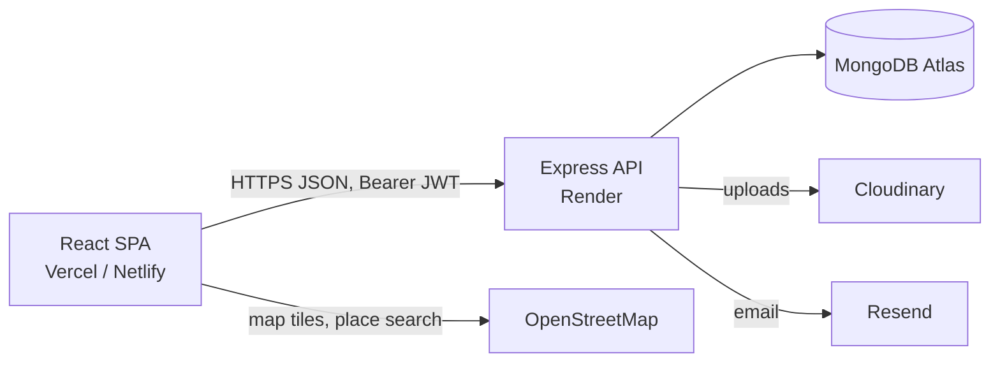

# Architecture

How MedEasy is put together. For endpoints see [API.md](API.md); for hosting see [DEPLOYMENT.md](DEPLOYMENT.md).

## System overview



- **Frontend** — a single-page app. Every page except the home page is code-split and loaded on demand;
  Leaflet (map) and Chart.js (admin charts) only load on the screens that use them.
- **API** — stateless Express server. Every request passes, in order: helmet → CORS allow-list →
  compression → JSON body limit (100 kB) → NoSQL-operator stripping → logging → rate limit →
  route-level auth, role check and Zod validation → controller → central error handler.
- **Database** — MongoDB via Mongoose. Schemas carry constraints and indexes; `PendingUser` has a 15-minute
  TTL index so abandoned sign-ups delete themselves.

## Roles

| Role | Signs up | Can |
| --- | --- | --- |
| Guest | – | Browse, buy over-the-counter medicines, track an order by number + phone, contact support |
| Patient | Self (email code) | Order (including prescription medicines), upload prescriptions, book doctors, review |
| Doctor | Self + Partner Agreement, then **admin approval** | Manage schedule, complete consultations, issue e-prescriptions |
| Pharmacy (owner) | Self + Partner Agreement, then **admin approval** | Inventory, orders, prescription verification, manage its pharmacist representative |
| Pharmacist (representative) | Added by a pharmacy, **admin-approved** | Same operational access as the pharmacy; signs in with their own email |
| Admin | Created by an admin | Users, verifications, catalogue, orders, appointments, reports, settings |

**Partners and commission.** Doctors and pharmacies accept the Partner Agreement (`/partner-agreement`,
version and rate in `backend/config/partner.js` and `frontend/src/lib/business.js`) at sign-up; the version,
rate and date are stored on the user. Partners who joined under an older version must accept the current one
in their dashboard before continuing. Every order records `commission` (10% of the medicines subtotal,
delivery excluded) and every booked consultation records `fee` and `commission` (10% of the fee); the admin
overview totals commission for the month.

Routes are guarded twice: in the SPA (`ProtectedRoute`, staff are redirected to their dashboards) and,
authoritatively, in the API (`protect` + `authorizeRoles`).

## Authentication and sessions

1. **Sign-up** stores a `PendingUser` (bcrypt password, SHA-256 of a 6-digit code) and emails the code.
2. **Verification** compares the code in constant time (5 attempts max), creates the `User` and returns a JWT.
   Doctors and pharmacies get `pendingReview` instead of a session until an admin approves them; a
   pharmacy's pharmacist representative is approved separately and can't sign in while the store is unapproved.
3. **Sessions** are JWTs (7 days) kept in `sessionStorage`, so each browser tab has its own session and
   closing the tab signs out. Tokens carry the user's `tokenVersion`; changing or resetting a password
   increments it, which ends every other session on the next request.
4. **Responses never contain secrets**: `User.toJSON` strips password hashes (including the
   representative's), reset codes and token versions.

Login and forgot-password give identical answers for unknown and existing accounts (and take the same
time), so they can't be used to discover who has an account.

## Data model

| Collection | Key fields | Notes |
| --- | --- | --- |
| `User` | name, email, phone, role, status, isVerifiedProfile, tokenVersion; doctor and pharmacy profile fields; `pharmacistDetails` (representative) | Phone normalised to `92XXXXXXXXXX` |
| `PendingUser` | registration details + hashed code | TTL 15 minutes |
| `Medicine` | name (generic + strength), brand, category, price, originalPrice, stock, requiresPrescription, imageUrl | One shared catalogue |
| `Order` | userId **or** guest {name, phone, email}, orderNumber `ME-XXXXXXXX`, items (price copied from the DB), deliveryFee, commission, totalAmount, status, payment, shippingAddress {…, notes, location {lat, lng}} | Stock is reserved atomically when placing; cancelling restocks once |
| `Prescription` | userId, fileUrl, status, notes, rejectionReason, reviewedBy | Verified by a pharmacist before Rx orders are confirmed |
| `Appointment` | patientId, doctorId, date, time, status, reason, notes, prescription, fee, commission | Only approved, active doctors can be booked |
| `Review` | userId, targetType (`medicine`/`doctor`/`pharmacy`), targetId, rating, comment | One review per user per target |
| `Contact` | name, email, phone, subject, message, role | Also emailed to support |

## Key flows

**Ordering.** The server takes medicine ids and quantities only: prices come from the database, stock is
decremented with a conditional update (no overselling), and the delivery fee is computed server-side
(flat fee, free above a threshold). Guests can only buy over-the-counter items and are limited to a few
open orders per phone number. Prescription items need a verified prescription before the pharmacy can
confirm the order.

**Delivery location.** The written address is required; a map pin is optional. The pin is validated to lie
inside Pakistan and stored with six decimals; pharmacy and admin views link straight to it in Google Maps.

**Prescriptions.** Patients upload an image or PDF (type and extension must agree, size-limited) to
Cloudinary; pharmacists approve or decline with a reason.

## Frontend structure

```
src/
  app/            App shell, providers, routes (lazy-loaded)
  components/ui/  Design system: Button, Input, Modal, Table, Tabs, Badge, EmptyState…
  components/     layout (Navbar, Footer, DashboardLayout), feedback, seo
  features/<x>/   pages/, components/, lib/ per domain (auth, cart, orders, admin, doctor, pharmacist…)
  context/        Auth, Notifications, Cart, Toast, AuthModal, Data (admin data)
  services/api/   Axios client + one module per domain
  lib/            env, formatting, geo (map helpers), theme helpers
  styles/         tokens.css (all colours and scales), bootstrap-overrides.css, base.css
```

**Design tokens.** Every colour, size and shadow lives in `styles/tokens.css`; Stylelint rejects raw colours
anywhere else. Light and dark themes switch the same tokens. `bootstrap-overrides.css` maps Bootstrap's
variables to the tokens so react-bootstrap components match.

## Notifications and chat

Both are stored on the server and work on the free hosting plans: no WebSockets or paid push service.

- **Notifications** are created by the API when something happens (booking, cancellation, order status,
  prescription decision, verification, new chat message) in `backend/utils/notify.js`. They never block the
  action that caused them. Staff alerts go to active admins and approved pharmacies. They are deleted
  automatically after 90 days (TTL index), which keeps the free database small. The site checks
  `GET /api/notifications` every 30 seconds while the tab is visible (`context/NotificationsContext.jsx`).
- **Chat** messages belong to an appointment (`Message` model); only its patient and doctor can write, and
  admins can read them. The chat is open until 3 days after the appointment and closed when it's cancelled.
  An open chat checks for new messages every 5 seconds, asking only for messages newer than the last one.
- **One alert per unread conversation**: more messages update the same notification instead of adding more.
  Only that first alert sends an email, and the email never contains the message. This keeps within
  Resend's free quota.
- Polling is rate-limited per user, not per IP, so people sharing a mobile network's IP don't block each other.

## Prescriptions

1. A patient uploads a prescription, either on its own page or at checkout. A pharmacist approves or
   declines it; decisions are final and listed under **Reviewed**.
2. An order for prescription-only medicines must carry a prescription that is pending or approved, at most
   30 days old, and not already used by another order that isn't cancelled. A pharmacist can mark a
   prescription as allowing repeat orders, which makes it reusable for 180 days. The rules live in
   `models/Prescription.js` (`unusableReason`). Checkout lists the patient's usable prescriptions.
3. An order can't be confirmed until its prescription is approved. Approving from the Prescriptions tab
   confirms the orders waiting on it in the same step.
4. **Offers.** A prescription sent on its own (a photo, or a MedEasy doctor's e-prescription the patient
   sends from a completed consultation) usually gets an offer instead: the pharmacist picks catalogue
   medicines and quantities, notes changes ("15 days' supply, prescribed 20"), offers alternatives and lists
   what can't be supplied. The offer is stored on the prescription (`offer`, with a `version`). The patient
   has 48 hours (`OFFER_HOURS`) to accept the lines they want, at the offered prices; that creates a
   confirmed order through the same stock reservation as checkout (`utils/orders.js`). Alternatives are
   never pre-selected for the patient.
5. Each prescription has a conversation between the patient and the pharmacy (`Message` with
   `prescriptionId`, alerts on thread `chat:rx:<id>`), open while the prescription is valid.

## Feedback and complaints

Site feedback, complaints about a consultation or an order, and pharmacy ratings are one `Feedback`
collection (`kind`: `site`, `doctor`, `order`, `rating`). The API checks that a complaint or rating is about
the sender's own appointment or order, and allows one rating per delivered order (rating again replaces it).
New complaints alert admins; resolving one tells the patient. Admins work through them in the Audits tab.

## Known limitations

- **Uploaded files use public URLs**: anyone with a prescription's link can open it. Signed or
  authenticated URLs would be better for health data.
- **Admin lists load every record**: fine at current volume; add server-side pagination as data grows.
- **One shared catalogue**: medicines and orders are not tied to a specific pharmacy, so routing orders to
  the nearest stocking pharmacy (and distance-based delivery fees) would need per-pharmacy inventory.
