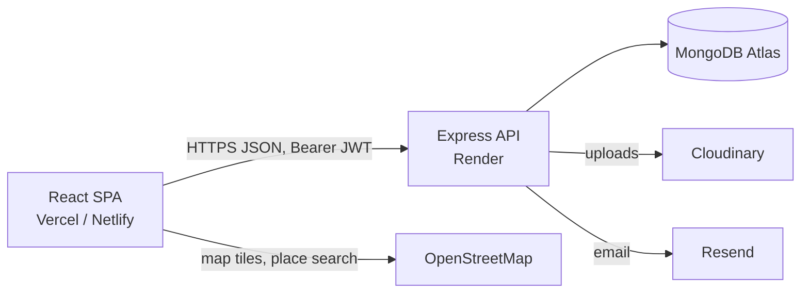

# Architecture

How MedEasy is put together. For endpoints see [API.md](API.md); for hosting see [DEPLOYMENT.md](DEPLOYMENT.md).

## System overview



- **Frontend** — a single-page app. Every page except the home page is code-split and loaded on demand;
  Leaflet (map) and Chart.js (admin charts) only load on the screens that use them.
- **API** — stateless Express server. Every request passes, in order: helmet → CORS allow-list →
  compression → JSON body limit (100 kB) → NoSQL-operator stripping → logging → rate limit →
  route-level auth, role check and Zod validation → controller → central error handler.
- **Database** — MongoDB via Mongoose. Schemas carry constraints and indexes; `PendingUser` has a 15-minute
  TTL index so abandoned sign-ups delete themselves.

## Roles

| Role | Signs up | Can |
| --- | --- | --- |
| Guest | – | Browse, buy over-the-counter medicines, track an order by number + phone, contact support |
| Patient | Self (email code) | Order (including prescription medicines), upload prescriptions, book doctors, review |
| Doctor | Self, then **admin approval** | Manage schedule, complete consultations, issue e-prescriptions |
| Pharmacy (owner) | Self | Inventory, orders, prescription verification, manage its pharmacist representative |
| Pharmacist (representative) | Added by a pharmacy, **admin-approved** | Same operational access as the pharmacy; signs in with their own email |
| Admin | Created by an admin | Users, verifications, catalogue, orders, appointments, reports, settings |

Routes are guarded twice: in the SPA (`ProtectedRoute`, staff are redirected to their dashboards) and,
authoritatively, in the API (`protect` + `authorizeRoles`).

## Authentication and sessions

1. **Sign-up** stores a `PendingUser` (bcrypt password, SHA-256 of a 6-digit code) and emails the code.
2. **Verification** compares the code in constant time (5 attempts max), creates the `User` and returns a JWT.
   Doctors get `pendingReview` instead of a session until an admin approves them.
3. **Sessions** are JWTs (7 days) kept in `sessionStorage`, so each browser tab has its own session and
   closing the tab signs out. Tokens carry the user's `tokenVersion`; changing or resetting a password
   increments it, which ends every other session on the next request.
4. **Responses never contain secrets**: `User.toJSON` strips password hashes (including the
   representative's), reset codes and token versions.

Login and forgot-password give identical answers for unknown and existing accounts (and take the same
time), so they can't be used to discover who has an account.

## Data model

| Collection | Key fields | Notes |
| --- | --- | --- |
| `User` | name, email, phone, role, status, isVerifiedProfile, tokenVersion; doctor and pharmacy profile fields; `pharmacistDetails` (representative) | Phone normalised to `92XXXXXXXXXX` |
| `PendingUser` | registration details + hashed code | TTL 15 minutes |
| `Medicine` | name (generic + strength), brand, category, price, originalPrice, stock, requiresPrescription, imageUrl | One shared catalogue |
| `Order` | userId **or** guest {name, phone, email}, orderNumber `ME-XXXXXXXX`, items (price copied from the DB), deliveryFee, totalAmount, status, payment, shippingAddress {…, notes, location {lat, lng}} | Stock is reserved atomically when placing; cancelling restocks once |
| `Prescription` | userId, fileUrl, status, notes, rejectionReason, reviewedBy | Verified by a pharmacist before Rx orders are confirmed |
| `Appointment` | patientId, doctorId, date, time, status, reason, notes, prescription | Only approved, active doctors can be booked |
| `Review` | userId, targetType (`medicine`/`doctor`/`pharmacy`), targetId, rating, comment | One review per user per target |
| `Contact` | name, email, phone, subject, message, role | Also emailed to support |

## Key flows

**Ordering.** The server takes medicine ids and quantities only: prices come from the database, stock is
decremented with a conditional update (no overselling), and the delivery fee is computed server-side
(flat fee, free above a threshold). Guests can only buy over-the-counter items and are limited to a few
open orders per phone number. Prescription items need a verified prescription before the pharmacy can
confirm the order.

**Delivery location.** The written address is required; a map pin is optional. The pin is validated to lie
inside Pakistan and stored with six decimals; pharmacy and admin views link straight to it in Google Maps.

**Prescriptions.** Patients upload an image or PDF (type and extension must agree, size-limited) to
Cloudinary; pharmacists approve or decline with a reason.

## Frontend structure

```
src/
  app/            App shell, providers, routes (lazy-loaded)
  components/ui/  Design system: Button, Input, Modal, Table, Tabs, Badge, EmptyState…
  components/     layout (Navbar, Footer, DashboardLayout), feedback, seo
  features/<x>/   pages/, components/, lib/ per domain (auth, cart, orders, admin, doctor, pharmacist…)
  context/        Auth, Cart, Toast, AuthModal, Data (admin data)
  services/api/   Axios client + one module per domain
  lib/            env, formatting, geo (map helpers), notifications, theme helpers
  styles/         tokens.css (all colours and scales), bootstrap-overrides.css, base.css
```

**Design tokens.** Every colour, size and shadow lives in `styles/tokens.css`; Stylelint rejects raw colours
anywhere else. Light and dark themes switch the same tokens. `bootstrap-overrides.css` maps Bootstrap's
variables to the tokens so react-bootstrap components match.

## Known limitations

- **Notifications, consultation chat and some feedback are stored in the browser** (`localStorage`), so they
  only appear on the device that created them. They should move to the API.
- **Uploaded files use public URLs**: anyone with a prescription's link can open it. Signed or
  authenticated URLs would be better for health data.
- **Admin lists load every record**: fine at current volume; add server-side pagination as data grows.
- **One shared catalogue**: medicines and orders are not tied to a specific pharmacy, so routing orders to
  the nearest stocking pharmacy (and distance-based delivery fees) would need per-pharmacy inventory.
